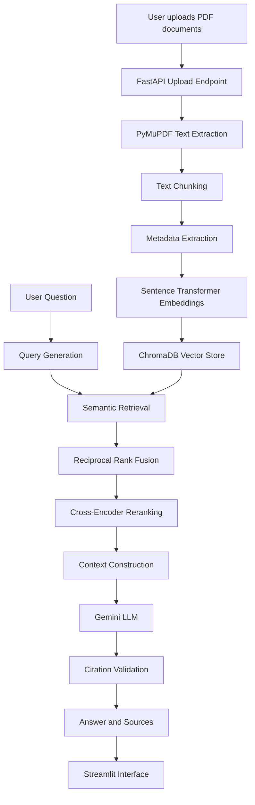

# 📚 DocuMind AI — Intelligent Multi-PDF Research Assistant

**DocuMind AI** is an AI-powered document research assistant that allows users to upload multiple PDF documents and ask natural-language questions about their contents.

Built using **Retrieval-Augmented Generation (RAG)**, the application retrieves relevant document passages, generates context-aware answers using Google's Gemini model, and provides source-page citations to improve transparency and reduce unsupported answers.

---

## ✨ Key Features

- **Multi-PDF Upload:** Upload and process multiple PDF documents.
- **PDF Text Extraction:** Extract text and page-level metadata using PyMuPDF.
- **Intelligent Chunking:** Split extracted text into manageable, overlapping chunks.
- **Semantic Search:** Generate vector embeddings using Sentence Transformers.
- **Persistent Vector Storage:** Store and retrieve document chunks using ChromaDB.
- **Multi-Query Retrieval:** Generate alternative search queries to improve retrieval coverage.
- **Reciprocal Rank Fusion (RRF):** Combine rankings from multiple search queries.
- **Cross-Encoder Reranking:** Improve the ordering of retrieved passages.
- **Document-Balanced Retrieval:** Balance retrieved candidates across indexed PDF documents.
- **Context-Aware Generation:** Generate answers using Google's Gemini model.
- **Source Citations:** Display document names and page numbers supporting generated answers.
- **Grounded Responses:** Use retrieved document context and abstain when sufficient supporting information is unavailable.
- **Interactive Interface:** Chat with uploaded documents through Streamlit.

---

## 🏗️ System Architecture



---

## ⚙️ Technology Stack

| Component | Technology |
|---|---|
| Programming Language | Python |
| Backend API | FastAPI |
| Frontend | Streamlit |
| PDF Processing | PyMuPDF |
| Text Chunking | LangChain Text Splitters |
| Embedding Model | all-MiniLM-L6-v2 |
| Vector Database | ChromaDB |
| Retrieval Strategy | Semantic Search + RRF |
| Reranking | Cross-Encoder |
| LLM | Google Gemini |
| Data Validation | Pydantic |
| Evaluation | Ragas, Precision@K, NDCG |
| Environment Management | Python Virtual Environment, dotenv |

---

## 🔄 RAG Pipeline

### 1. Document Ingestion

- Accept PDF documents through the upload interface.
- Extract text page by page.
- Preserve source filename and page number as metadata.

### 2. Text Chunking

- Split extracted text into smaller chunks.
- Chunk size: 500 characters.
- Chunk overlap: 50 characters.
- Preserve metadata for source traceability.

### 3. Embedding Generation

- Use the `all-MiniLM-L6-v2` Sentence Transformer model.
- Convert text chunks into 384-dimensional vector embeddings.

### 4. Vector Storage

- Store embeddings, text, and metadata in ChromaDB.
- Use persistent storage for document retrieval across application restarts.

### 5. Retrieval and Reranking

- Generate alternative search queries.
- Retrieve semantically relevant chunks.
- Combine rankings using Reciprocal Rank Fusion.
- Rerank candidates using a Cross-Encoder.
- Expand selected chunks with neighboring passages where available.

### 6. Answer Generation

- Construct context from retrieved passages.
- Send the original question and retrieved context to Gemini.
- Generate an answer grounded in the supplied documents.

### 7. Citation Validation

- Validate generated source-page references against retrieved metadata.
- Flag unverified citations.
- Hide source metadata when the application returns its configured abstention response.

---

## 📂 Project Structure

```text
DocuMind-AI/
│
├── backend/
│   ├── __init__.py
│   ├── main.py
│   ├── api.py
│   ├── pdf_processor.py
│   ├── chunking.py
│   ├── embeddings.py
│   ├── vector_store.py
│   ├── retrieval.py
│   ├── llm.py
│   └── prompts.py
│
├── frontend/
│   └── app.py
│
├── evaluation/
│   ├── test_dataset.json
│   ├── test_ragas.py
│   ├── run_expanded_benchmark.py
│   ├── expanded_metrics.py
│   ├── expanded_retrieval_results.json
│   ├── expanded_relevance_labels.json
│   └── expanded_metrics_report.json
│
├── tests/
│   └── test_pipeline.py
│
├── data/
│   ├── uploads/
│   └── chroma_db/
│
├── .env
├── .gitignore
├── requirements.txt
└── README.md
```

---

## 🚀 Installation and Setup

### Prerequisites

- Python 3.11 or later
- Git
- Google Gemini API key

### 1. Clone the repository

```bash
git clone https://github.com/shivani-tomar10/DocuMind-AI.git

cd DocuMind-AI
```

### 2. Create a virtual environment

```bash
python -m venv venv
```

Activate it:

**macOS / Linux**

```bash
source venv/bin/activate
```

**Windows**

```bash
venv\Scripts\activate
```

### 3. Install dependencies

```bash
pip install -r requirements.txt
```

### 4. Configure environment variables

Create a `.env` file in the project root:

```env
GEMINI_API_KEY=your_gemini_api_key
```

Never commit your API key or `.env` file to GitHub.

### 5. Start the FastAPI backend

```bash
uvicorn backend.api:app --reload
```

Backend API:

```text
http://127.0.0.1:8000
```

Swagger documentation:

```text
http://127.0.0.1:8000/docs
```

### 6. Start the Streamlit frontend

Open a second terminal, activate the virtual environment, and run:

```bash
streamlit run frontend/app.py
```

Frontend:

```text
http://localhost:8501
```

---

## 🔌 API Endpoints

| Method | Endpoint | Description |
|---|---|---|
| GET | `/` | Check backend status |
| POST | `/upload` | Upload and process a PDF |
| POST | `/ask` | Ask questions about uploaded documents |

### Example: Ask a question

**POST** `/ask`

```json
{
  "question": "What is SQL?",
  "search_all_documents": false
}
```

The response includes:

- Original question
- Generated answer
- Source filenames and page numbers
- Citation validation information
- Search queries
- Retrieved and expanded chunk counts

---

## 📊 Evaluation

The retrieval system was evaluated using a manually labeled benchmark containing:

- 20 questions
- 18 answerable questions
- 2 unanswerable questions
- Five retrieved chunks per question

### Retrieval evaluation results

| Metric | Result |
|---|---:|
| Average Precision@5 | 83.33% |
| Average NDCG@5 | 90.87% |
| Unanswerable retrieval false-positive rate | 0% |

**Evaluation notes:**

- Precision@5 treats partially relevant and highly relevant chunks as relevant.
- NDCG@5 uses graded relevance judgments.
- The relevance labels are preliminary human judgments.
- Recall@5 was not calculated because relevance was not labeled across the full document collection.
- The 0% unanswerable retrieval false-positive rate applies only to the two benchmark questions and their retrieved chunks. It does not establish a general hallucination rate.

### RAG evaluation using Ragas

Four RAG evaluation metrics were tested:

- Faithfulness
- Context Precision
- Context Recall
- Answer Relevancy

The initial evaluation covered seven answerable questions with available reference answers.

---

## 🛡️ Error Handling and Reliability

- Validate uploaded file types.
- Reject empty files.
- Enforce the backend's configured upload-size limit.
- Handle PDF extraction errors.
- Handle empty retrieval results.
- Validate generated citations against retrieved source metadata.
- Return an abstention response when the requested information cannot be found in the retrieved context.

**Current limitations:**

- Scanned PDFs without extractable text require OCR support.
- Retrieval quality depends on document quality, chunking, and query formulation.
- Citation validation checks source-page membership, not whether every individual claim is supported by the cited passage.
- Retrieval and RAG evaluation results are preliminary and should be expanded before production use.

---

## 🔮 Future Improvements

- Hybrid retrieval using BM25 and semantic search.
- Advanced query rewriting and intent detection.
- Improved citation-to-claim verification.
- OCR support for scanned PDFs.
- User authentication and document-level access control.
- Conversation memory and chat history.
- Automated evaluation and regression testing.

---

## 👩‍💻 Author

**SHIVANI TOMAR**

AI/ML Engineer | Python | RAG | FastAPI | Generative AI

GitHub: https://github.com/shivani-tomar10/

LinkedIn: https://www.linkedin.com/in/shivani-tomar10/

---

## 📄 Project Usage

This project is intended for educational, portfolio, and research purposes.
